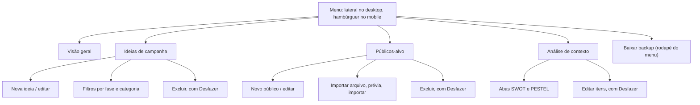

# Análise de UX — heurísticas de Nielsen e navegação

Plataforma Figo × UFC (ideias, orçamento, públicos-alvo e análise de contexto).

## Como esta análise foi feita (e o que ela não cobre)

- **Método:** avaliação heurística de especialista, feita sobre o código, sobre os fluxos executados em testes automatizados (navegador simulado) e sobre capturas de tela do layout mobile. Foi uma única avaliadora; o ideal são 3 a 5, porque cada pessoa enxerga problemas diferentes.
- **Não foi feito:** teste com usuários reais, leitor de tela, auditoria automática de acessibilidade (axe, Lighthouse) nem teste em aparelhos físicos. Os números de contraste foram calculados à mão e valem como estimativa.
- **Severidade** (escala de Nielsen): 0 = não é problema, 1 = cosmético, 2 = menor, 3 = maior, 4 = catastrófico. A coluna "antes" descreve a versão anterior a este ajuste; "depois" é a situação atual.

---

## 1. Mapa de navegação

### Custo das tarefas principais (em cliques ou toques)

| Tarefa | Desktop | Mobile |
| --- | --- | --- |
| Ver orçamento disponível | 0 (é a tela inicial) | 0 |
| Cadastrar uma ideia | 3 (Ideias → Nova ideia → Adicionar) | 4 (inclui abrir o menu) |
| Cadastrar um público manualmente | 3 | 4 |
| Importar públicos de um arquivo | 2 a 3 (Públicos → arrastar ou escolher arquivo → Importar) | 3 a 4 |
| Consultar o SWOT | 1 | 2 |
| Consultar o PESTEL | 2 | 3 |
| Remover um item do SWOT | 3 (Análise → Editar itens → ×) | 4 |
| Baixar backup | 1 | 2 |

Nenhuma tarefa principal passa de 4 passos. O ponto fraco é o custo extra de abrir o menu no mobile, que é o preço de ter a tela livre.

---

## 2. Avaliação pelas 10 heurísticas

| # | Heurística | Antes (severidade) | O que foi feito | O que ainda falta (severidade depois) |
| --- | --- | --- | --- | --- |
| 1 | Visibilidade do status do sistema | O estado da sincronização só aparecia no rodapé do menu lateral, **escondido no mobile**; salvar ou excluir não dava retorno (3) | Status na barra superior do mobile ("Ao vivo", "Salvando…", "Offline", "Local"); avisos ao adicionar, atualizar, excluir e importar; aviso quando o total alocado passa do orçamento; aviso quando a gravação falha; título da aba e item de menu atual mudam por tela | Não mostra quem editou nem quando foi a última atualização (1) |
| 2 | Correspondência com o mundo real | Linguagem em português, termos do próprio projeto e valores em US$. "Carga por fase" e "Alocado" são jargão leve de gestão (1) | Mantido | Nada relevante (1) |
| 3 | Controle e liberdade do usuário | Excluir pedia confirmação mas não tinha desfazer; **remover item de SWOT/PESTEL era imediato e irreversível**; Esc não fechava nada (3) | Desfazer por 9 segundos em exclusões de ideia, público e item de análise; Esc fecha o menu e formulários vazios (formulário com texto digitado não é descartado); botão Cancelar em todos os formulários | Passados os 9 segundos não há como recuperar (sem lixeira ou histórico). No modo equipe, os outros veem a exclusão na hora (1) |
| 4 | Consistência e padrões | Botão primário roxo, secundário com contorno, blocos iguais em todas as telas. Pequenas diferenças: as abas SWOT/PESTEL ficam no cabeçalho da página, enquanto os filtros ficam no cabeçalho do bloco (1) | Mantido | Padronizar onde ficam controles de visualização (1) |
| 5 | Prevenção de erros | **"12.000" era lido como 12** (erro de interpretação do formato brasileiro), texto não numérico virava 0 sem aviso, públicos com o mesmo nome eram aceitos (as ideias ligam ao público pelo nome) e o estouro do orçamento só aparecia na Visão geral (4) | Aceita 12000, 12.000, 12.000,50 e 12,5; recusa texto e negativos com mensagem; bloqueia nome de público repetido; avisa ao estourar o orçamento; fonte de 16 px nos campos do mobile para o iPhone não ampliar a tela ao digitar | Na importação, o app desmarca públicos repetidos, mas dá para marcá-los de novo à mão (1) |
| 6 | Reconhecimento em vez de memorização | Menu com ícone e texto, listas de opções visíveis, rótulos em todos os campos. **No mobile, a barra de navegação rolava na horizontal e escondia itens fora da tela** (2) | O hambúrguer mostra todos os destinos juntos, com o contador de ideias e públicos; dica de formato no campo de custo | Nada relevante (0) |
| 7 | Flexibilidade e eficiência de uso | Sem atalhos: Enter não enviava formulários e, ao adicionar vários itens de SWOT, era preciso clicar no campo de novo (2) | Enter envia os formulários e o campo de item de análise; o foco volta ao campo para adicionar em sequência; formulários abrem com o cursor no primeiro campo; link "Pular para o conteúdo" | Sem duplicar ideia, edição em massa, ordenação escolhida pelo usuário nem busca por texto. Pesa quando houver dezenas de ideias (2) |
| 8 | Design estético e minimalista | Visual limpo, um só destaque de cor, informação em blocos. O formulário de público mostra 48 campos de uma vez; a área de importação ocupava um bloco inteiro mesmo com públicos já cadastrados (2) | A área de importação fica compacta depois do primeiro público | Formulário de público ainda é longo, sobretudo no celular. Opção: grupos recolhíveis no mobile (2) |
| 9 | Ajudar a reconhecer, diagnosticar e corrigir erros | Nome em branco só deixava a borda vermelha, **sem texto explicando** (3). Erros de importação e de conexão já eram claros | Mensagem ao lado do campo, foco levado ao campo com problema e dados digitados preservados; a mensagem some ao corrigir | A tela de falha de conexão não diferencia "sem internet" de "regras do banco bloqueando" (1) |
| 10 | Ajuda e documentação | Só o README, fora do app (2) | Subtítulo em cada tela, exemplos nos campos, dica de formato do custo, estados vazios que dizem o que fazer, nota explicando como o importador reconhece os campos | Não há ajuda dentro do app (ex.: "Como usar" com 5 perguntas) (2) |

### Acessibilidade (complementar às heurísticas)

- **Contraste:** o cinza dos textos secundários dava cerca de 2,9:1 sobre branco (abaixo dos 4,5:1 recomendados); passou para cerca de 5:1 no tema claro e foi ajustado no escuro.
- **Foco visível** em todos os controles; **alvos de toque** de 44 px no hambúrguer e no fechar do menu, e controles de texto maiores no mobile.
- **Semântica:** `aria-current` no menu, `aria-expanded` no hambúrguer, abas com `role="tab"`, avisos em região `aria-live`, conteúdo de fundo desativado enquanto o menu está aberto, foco devolvido ao botão ao fechar.
- **Movimento:** as animações são desligadas para quem pede menos movimento no sistema.

---

## 3. Análise da navegação

### O que funciona
- Quatro destinos de primeiro nível, com nomes do domínio do projeto. Nada fica a mais de um nível de profundidade.
- Sempre dá para saber onde se está: item ativo destacado, título grande da tela, título da aba do navegador.
- A Visão geral como tela inicial responde logo à pergunta mais comum: "quanto já foi alocado e onde?".
- As ações principais ficam no topo da própria tela (Nova ideia, Novo público-alvo, Editar itens), sem procurar em menus.
- No celular, o menu fecha ao escolher um destino e o foco vai para o título da nova tela.

### Problemas encontrados
1. **A ordem do menu não segue o fluxo de trabalho** (severidade 2). Hoje é Visão geral → Ideias → Públicos → Análise, mas o trabalho tende a ir de contexto (Análise) para públicos e só então para ideias; além disso, o campo "Público" das ideias depende de públicos já cadastrados. Recomendação: Visão geral → Análise → Públicos → Ideias, ou deixar a decisão com a equipe.
2. **A tela atual não aparece no endereço** (severidade 2). Ao recarregar a página, o app volta à Visão geral; o botão Voltar do navegador (e do Android) sai do app em vez de voltar à tela anterior; não dá para mandar um link direto para "Ideias". Recomendação: usar `#/ideias`, `#/publicos` etc. na URL. É uma mudança pequena.
3. **O backup está escondido** no rodapé do menu, e no celular exige abrir o menu (severidade 1). Para um recurso de segurança dos dados, vale um lugar mais visível ou um lembrete antes das entregas.
4. **Poucas formas de achar coisas quando o volume crescer** (severidade 2). Os filtros cobrem fase e categoria; faltam busca por texto e filtro por status ou público.
5. **Formulário de público longo** (severidade 2): 48 campos, sem indicação de progresso e sem rascunho salvo se a pessoa sair da tela.

---

## 4. Prioridades sugeridas

| Prioridade | Ação | Esforço |
| --- | --- | --- |
| Alta | Guardar a tela atual na URL (`#/ideias`) para o botão Voltar e os links diretos funcionarem | Baixo |
| Alta | Testar com 3 a 5 pessoas da equipe (roteiro abaixo) | Baixo |
| Média | Reordenar o menu pelo fluxo de trabalho, se a equipe concordar | Baixo |
| Média | Busca por texto e filtro por status nas ideias | Médio |
| Média | Grupos recolhíveis e rascunho no formulário de público | Médio |
| Baixa | Painel "Como usar" dentro do app | Médio |

## 5. Roteiro de teste com usuários (para validar esta avaliação)

Peça a cada pessoa que faça as tarefas em voz alta, sem ajuda, primeiro no celular e depois no computador. Anote onde hesita, onde erra e quanto tempo leva.

1. Descobrir quanto do orçamento ainda está livre.
2. Cadastrar uma ideia de campanha de US$ 12.000 e dizer se o orçamento ficou dentro do limite.
3. Importar o PDF de públicos-alvo e conferir o que foi reconhecido.
4. Excluir uma ideia por engano e recuperá-la.
5. Achar um ponto fraco do UFC no SWOT e acrescentar uma observação nova.

**Como medir:** conseguiu sem ajuda (sim/não), tempo por tarefa, erros e comentários. Se 2 ou mais pessoas travarem no mesmo ponto, trate como problema real.
